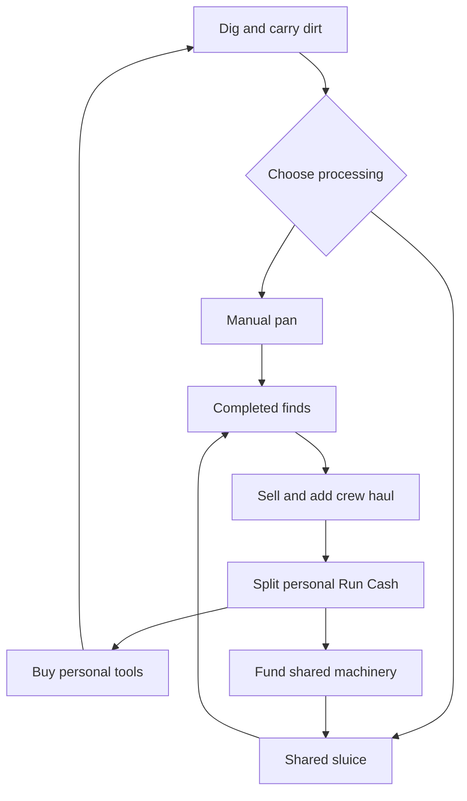

# Gold Rush Simulator MVP Draft

Version 0.1 • 19 October 2026, America/Los_Angeles • Status: proposed design for roadmap planning

## 1 Product definition

**Build a cooperative Roblox game in which one to four players turn a small river camp into a gold-processing operation during a ten-minute shift.** Players dig, sift, discover valuable or ridiculous objects, sell the haul, and reinvest in tools and shared machinery. At the bell, the camp resets, while class progress, pets, a discovery collection, and personal records carry forward.

The repeat-play promise is: **“Next shift, our crew can build the sluice earlier and bring home a bigger haul.”**

The main differentiator is the timed cooperative operation. Prospecting already offers river panning, gems, equipment upgrades, and sluice automation. The ten-minute arc, shared production decisions, and temporary builds must be central to this game's identity. [Prospecting official description](https://www.roblox.com/games/129827112113663/Prospecting)

This is a design brief for another agent to turn into a dependency-aware roadmap. It is not a claim that the economy is balanced or that the game has been built. All prices, probabilities, timings, progression amounts, and test thresholds below are **provisional tuning inputs**. Decisions in Section 17 remain open; the defaults below allow planning to proceed before answers arrive.

### Product goals

- A new player understands dig → sift → sell → upgrade within the first minute of a run.
- Cooperation changes the operation: players share production, sale revenue, and machine funding.
- A fresh account and a returning account can enjoy the same run.
- A complete shift has an opening, a visible automation upgrade, a meaningful night event, and a clear finish.
- Earning and buying power are supported, with the scope of each purchase stated precisely.

### Design assumptions

The initial audience wants accessible, humorous simulator gameplay with friends. Desktop and touch controls are first-release targets. Tone is an energetic, cartoon gold rush; pressure comes from the clock and production choices. There is no combat or survival failure in this draft.

“Collaborative” is interpreted as in-game cooperation. No development team size, budget, deadline, existing codebase, or art pipeline has been supplied, so this brief does not invent a delivery schedule.

## 2 Research basis

The examples below are references for selected structures, not templates to copy wholesale. Roblox's June 24, 2025 engineering article reports Grow a Garden reaching 21.6 million concurrent users, Dead Rails reaching one million in March 2025, and identifies Fisch among successful experiences. Its Q2 2025 shareholder letter places Dead Rails among the top ten experiences by Robux spend in June and identifies 99 Nights in the Forest as a viral hit in July. These are dated historical observations, not current rankings. [Roblox engineering report](https://about.roblox.com/newsroom/2025/06/roblox-infrastructure-supporting-record-breaking-games) · [Roblox Q2 2025 shareholder letter](https://www.sec.gov/Archives/edgar/data/1315098/000131509825000261/q225shletterex992.htm)

| Reference | Verified feature | Proposed application |
| --- | --- | --- |
| Prospecting | River panning, rare treasures, gear upgrades, and sluices, including offline automation. | Treat it as the closest competitor. Differentiate through a cooperative shift and rebuilding the operation. |
| Fisch | An active fishing interaction, unusual catches, exploration, and progression. | Make sifting tactile and discoveries worth showing the crew. Start with one small map. |
| Grow a Garden | A simple purchase, grow, harvest, and profit loop; players show finds to friends. | Make improvement visible in the camp and use short, shared rare-find reveals. |
| Dead Rails | Friends travel together by train toward a common objective. | Give the group one physical operation and one measurable result. |
| 99 Nights in the Forest | Building a camp with friends is central to its official premise. | Anchor cooperation around the camp and give night a recognizable gameplay change. |
| Bee Swarm Simulator | Gathering pollen, converting it into honey, and developing helpers with distinct traits. | Keep the material-conversion loop legible and give three pets understandable jobs. |

Mechanic sources: [Prospecting](https://www.roblox.com/games/129827112113663/Prospecting), [Fisch](https://www.roblox.com/games/16732694052/Fisch), [Grow a Garden](https://www.roblox.com/games/126884695634066/Grow-a-Garden), [Dead Rails](https://www.roblox.com/games/116495829188952/Dead-Rails), [99 Nights](https://www.roblox.com/games/79546208627805/99-Nights-in-the-Forest), and [Bee Swarm Simulator](https://www.roblox.com/games/1537690962/Bee-Swarm-Simulator).

**Design inference:** simple production, social discoveries, a shared objective, and small permanent goals are a coherent foundation for this concept. These sources do not establish that any isolated mechanic caused a game's success. Prospecting and Bee Swarm are included for mechanical relevance; this brief attaches no unverified popularity statistic to them.

## 3 Release scope and content budget

**Core validation MVP: Gates A–C.** Prove the manual loop, cooperation, automation, and ten-minute arc with placeholder art and starter loadouts. **Proposed public-launch package: Gates D–E.** Add the small class/pet systems, lobby reliability, and monetization after that evidence exists.

P0 below means required for that proposed public-launch package, not required to test the central idea. With an unknown team size, do not treat all P0 systems as a single first build. P1 is the first expansion backlog, subject to playtests. P2 is a later candidate list.

| System | P0 public MVP |
| --- | --- |
| Session | One lobby, one run map, one 600-second mode, parties of one to four |
| Core interaction | Dig, carry, manually sift, reveal, sell, buy, and contribute |
| Tools | Three shovel tiers and three pan tiers, including starter tiers |
| Automation | One shared sluice with two tiers, plus one hopper attachment |
| Map | A normal bank, camp, richer night bank, and fixed equipment pads |
| Finds | Ten top-level find categories, including one mystery crate |
| Events | One night deposit event and one final processing surge |
| Classes | Three permanent classes, each with three small upgrade nodes |
| Pets | Three pet types, one egg type, one equipped slot, three pet levels |
| Persistence | Tokens, class unlocks and nodes, pets, discoveries, records, and entitlements |
| Records | Personal best crew haul by party size, assistance flag, and rules version |
| Monetization | 2× Personal Run Cash pass and direct chosen-class unlocks |
| Reliability | Party admission, retryable teleports, limited same-server rejoin, durable completed rewards |
| UX and measurement | First-run guidance, result screen, replay, touch support, key funnel events |

**P1 candidates:** premium starter tools, paid hopper access, consumable run-upgrade vouchers, paid class rolls, a second map, one additional event, and a standardized competitive mode. Each needs its own acceptance criteria; nothing in this list is silently included in P0.

**P2 candidates:** autonomous digging, conveyor construction, large class trees, numerous pet tiers, pet fusion, player trading, offline production, procedural terrain, rebirths, seasonal passes, and scheduled live events. Combat, theft, hunger, death, and revives require a separate decision about the game's genre.

## 4 The ten-minute shift

Time begins after the admitted party has loaded and finished a three-second ready countdown. Lobby time and loading time are outside the 600 seconds. The first-run tutorial uses contextual prompts during the same ruleset; it does not extend the timer.

| Run time | World and player experience |
| --- | --- |
| 0:00–2:00 | Daylight. Learn or optimize the manual loop; buy an early tool upgrade and begin funding the sluice. |
| 2:00–5:00 | Daylight. Build the sluice, choose tool upgrades versus camp funding, and start moving dirt into shared processing. |
| 5:00–8:00 | Night. A marked bank farther from camp opens with 1.5× base-value material. The ordinary bank remains available. |
| 8:00–9:00 | Dawn. The richer bank closes to new digging. Material already gathered keeps its source bonus. |
| 9:00–10:00 | Final rush. All manual pans and sluices process 25% faster. A visible countdown encourages clearing dirt and output. |
| 10:00 | Stop accepting production actions, finish settlement, automatically sell all completed finds, and award the result once. |

Night changes a production decision: keep the sluice supplied from the nearby bank, or travel farther for more valuable material. Start the rich bank at roughly 6–7 seconds' one-way travel from camp, compared with 3–4 seconds for the ordinary bank. It has enough material for the crew; players cannot exhaust the entire event before teammates reach it. Test the complete collection-and-processing cycle: the 1.5× value must justify the extra travel for a useful solo or crew strategy. Tune distance, carry capacity, and value together if the richer route is consistently worse.

There is no extraction failure. **Finished treasure is automatically sold at the bell; unprocessed dirt and incomplete processing are discarded.** Display this rule at the start, at 9:00, and in the inventory labels. A processing result counts only if its server completion time is at or before the run end.

The result screen shows crew haul, a personal-best comparison, each player's useful contributions, token rewards, pet progress, new discoveries, and one visible next unlock. Offer “Play again with this crew” and “Return to lobby.”

After durable settlement, use a 20-second results decision window. Finish early if everyone chooses. Replay voters return together to a lobby party; players choosing Return or timing out leave that party. Keep the original leader if they opt in, otherwise promote the first remaining member in original roster order. One replay voter can form a solo party. In the lobby, the retained crew can change classes and pets, then use the normal ready and admission flow. No player can hold the crew past the decision window.

## 5 Player journey and interaction

### Lobby and party

Spawn in a compact lobby with the run portal immediately visible. Put classes, pets, and records near the route to the portal. First-time players receive a shovel, pan, bucket, and the Prospector class without opening a shop.

A portal allows a party creator to select capacity one through four and choose an open lobby party or invited crew. Solo launch is immediate after ready. An open party can launch partially filled; it never requires four players. Matchmaking starts with players already in the same lobby; global cross-server matching is outside P0.

All admitted players must be ready before transfer. Lock the roster for launch, reserve the run server, and wait up to 30 seconds for arrivals. If the admitted roster fails to arrive, cancel that launch and return arrived members with a retry option. Do not start a timer for a partially teleported party. Lobby retries must work without consuming anything.

No new players join a shift after its timer begins. A returning roster member may rejoin the same live run under Section 12.

### Core controls

Use a contextual action button with keyboard, mouse, controller-compatible input mappings, and an explicit touch button. Holding or toggling the action is sufficient; repeated rapid clicking is not required. Canceling an action gives no new loot roll.

| Action | Starting rule |
| --- | --- |
| Dig | One second acquires one batch of five dirt at a valid deposit |
| Carry | Starter bucket holds five batches, or 25 dirt |
| Manual sift | Four seconds processes one five-dirt batch at the river |
| Reveal | A short sound and visual reveal; rare finds also create a brief crew banner |
| Store | Completed personal finds use an output bag; starting capacity is 20 finds |
| Sell | One “Sell all” action at camp sells the player's output bag and available shared output |
| Share dirt | Any player can deposit into or withdraw whole batches from the free camp bin |
| Feed | Any player can load dirt into shared machinery |
| Upgrade | Buy a personal tool or contribute toward a posted shared-machine cost |

Every player can perform every action. No class is mandatory for solo play or access to an event. Each player has their own manual pan interaction, so a teammate cannot occupy the only usable sifting station.

A free shared dirt bin at camp holds 20 × N batches from the start. Anyone can deposit or withdraw whole batches within capacity, retaining the source and original digger. A Panner can therefore process a teammate's dirt before any automation exists. The hopper later feeds from this same bin; it does not create a second storage inventory. Batch transfers are atomic.

Digging and manual sifting are mutually exclusive player actions; machines continue independently. Reserve an output slot when processing starts. A full personal bag or machine buffer prevents new processing without consuming dirt. Snapshot processing rate at batch start, so phase and teammate-bonus changes affect subsequent batches.

**Opening protection:** the first five batches dug by each player in every run reveal Gold Flakes worth 12 each. That creates a predictable opening worth 60 per player before ordinary loot randomness. The discovery collection is not a second payout for those finds.

After the opening, use the loot table in Section 8. Assign and retain the full server-side result for a batch when it is created, including any nested crate outcome, source multiplier, and original digger; reveal it only on completed processing. Moving, canceling, or changing processors cannot reroll it. Preserve each player's first-five-batch counter across reconnects. The guaranteed Gold Flakes use base value 12, with any valid source bonus applied normally.

The production diagram distinguishes raw inputs, completed output, and the two reinvestment paths:

## 6 Cooperation and money ownership

### One shared result with personal spending control

Every sale contributes its full base value to **Crew Haul**, regardless of who dug, processed, or sold it. Every eligible connected crew member receives an equal share of the base Run Cash. Players spend their own wallets and may contribute any amount toward a fixed shared-machine pad.

This lets someone specialize in feeding or processing without being paid less than the person holding the shovel. It also prevents a teammate from directly spending another player's wallet.

Example: four eligible players sell finds worth 200. Crew Haul increases by 200. Each player receives 50 Run Cash. If one player has 2× Personal Run Cash, that player receives 100; the other three still receive 50. The additional 50 is tracked as premium bonus cash and does not directly increase Crew Haul.

Use fixed-point values internally. Allocate any rounding remainder deterministically so base payouts sum exactly to the sale value. A successful manual sale refreshes its actor's activity before the atomic eligibility snapshot. If there are zero eligible recipients, the sale still increases Crew Haul and consumes the finds once, but no Run Cash is distributed or held for later.

### Ownership rules

- **Discovery credit:** the original digger is named in the reveal, even when a teammate processes the batch.
- **Collection entry:** all connected, eligible players at reveal receive a pending discovery entry.
- **Cash allocation:** equal shares under the eligibility rule, independent of discovery credit.
- **Crew score:** count each sold find once, including automatic final sales.
- **Machines:** owned by the run and usable by the whole crew.
- **Contribution credit:** record digging, processing, feeding, selling, and funding separately. Do not award permanent currency through a winner-takes-all MVP title.

A player becomes inactive after 60 seconds without a successful gameplay action such as digging, processing, transferring dirt, loading, selling, or contributing. Only actions that change production or economy state refresh activity. Empty sales, zero contributions, rejected actions, UI activity, movement alone, and passive machine output do not. Give a ten-second warning before pausing cash shares; a valid action resumes them. A player entering the run receives an initial 60-second grace period. Define active time using this same eligibility state.

This is a basic AFK rule, not a promise to eliminate alternate-account farming. Observe whether it incorrectly excludes legitimate support play before tightening it.

### Shared purchases

Show the full price, amount funded, contributors, and exact effect on the pad. Contributions are voluntary, final within the shift, and capped at the unpaid amount. Build once when fully funded. Unfinished funding expires with the run, just as unspent Run Cash does. There are no player refunds, demolition, or cash transfers in P0.

The server serializes contributions and purchases. Two simultaneous final contributions cannot create two machines or deduct more than the remaining cost.

## 7 Economy and scoring

### Two spendable currencies

| Value | Earned from | Used for | Survives the run |
| --- | --- | --- | --- |
| Run Cash | Sale shares and an explicitly recorded paid cash multiplier | Temporary tools and shared-machine contributions | No |
| Claim Tokens | Eligible completed runs and max-level pet duplicates | Permanent class unlocks and class nodes | Yes |
| Pet XP | Completing runs with the pet equipped, plus pet duplicates | Pet level thresholds; not a spendable currency | Yes |
| Robux | Roblox purchase flow | Listed entitlements | Managed as purchases, not another in-game wallet |

A gem found in the river is an item with a sale value, not a third currency. Do not sell Claim Tokens in P0.

**Crew Haul = sum of the base sale values of all completed, sold finds.** Include earned source bonuses, such as material collected at the night bank. Exclude starter grants, purchases, premium bonus cash, unsifted dirt, and the remaining wallet balance. Tool and machine purchases do not subtract from Crew Haul.

A crew can earn 3,000, spend 2,000 on machinery, and still finish with a 3,000 haul. This prevents “never upgrade” from becoming the high-score strategy.

Let N be the party size locked when the run begins. For an eligible completion, every qualifying player receives:

**Claim Tokens = 20 + min(20, floor(Crew Haul ÷ (500 × N))).**

Example: a four-player crew finishes with 12,000 Crew Haul. Each qualifying player receives 20 + floor(12,000 ÷ 2,000) = **26 Claim Tokens**.

Eligibility requires at least 480 active seconds during the shift. This same completion eligibility awards pet XP and advances the egg milestone. Participation for less than 480 seconds does not grant these completion rewards. Discovered collection entries can still be committed independently; they do not pay tokens.

The formula gives a meaningful completion reward, adds a bounded performance bonus, and reduces the basic party-size advantage in permanent payouts. It does not guarantee perfect party or progression balance.

### Records

Save personal best crew results in separate buckets for N = 1, 2, 3, and 4, plus assistance status and rules version. Each qualifying participant records the same crew score.

At launch, mark a run **Assisted** if any admitted player's applied loadout includes paid power, including the cash pass or an equipped class obtained through a paid unlock. Use the recorded purchase provenance for a paid class. Cosmetic-only ownership does not mark assistance. The assistance flag is fixed for the entire run, including after a paying player leaves. Snapshot entitlements at launch; purchases during a shift begin affecting the next shift.

The unassisted label means no paid power benefit was applied; it is not a standardized competitive mode. Earned classes and pets still change power. A paid cash bonus can also buy earlier machinery and indirectly increase base haul. **Removing its direct multiplier from the score does not make the run competitively equal.**

P0 has personal records and a crew result screen, without global ranked rewards. A future standardized leaderboard needs normalized loadouts, disabled paid power, and a defined seed/event policy. Keep old records with their rules version when balance changes; do not mix incompatible scores or silently delete history.

## 8 Finds and starter tuning

Each ordinary five-dirt batch produces one top-level find. The first-five-batch rule overrides this table. These values are proposed inputs, not probabilities taken from another game.

| Find | Probability | Base sale value |
| --- | ---: | ---: |
| Old Boot | 20% | 3 |
| Tin Can | 10% | 2 |
| Rusty Coin | 10% | 8 |
| Small Fish | 10% | 10 |
| Gold Flakes | 30% | 12 |
| Gold Nugget | 12% | 30 |
| Silver Ring | 4% | 55 |
| Sapphire | 2% | 120 |
| Ruby | 1.5% | 220 |
| Mystery Crate | 0.5% | Variable; expected value 150 |
| **Total** | **100%** | **Expected value 18.45 per ordinary batch** |

The Mystery Crate automatically reveals a gold cache with base value 50 at 40%, 150 at 40%, or 350 at 20%. Those are conditional probabilities within the crate; their overall batch probabilities are 0.2%, 0.2%, and 0.1%. The cache is sold through the normal pipeline. It is not an additional payout on top of a crate sale.

Mystery Crates require no keys or purchase. Reuse a gold-cache model for the three amounts. The physical fish and junk are funny discoveries; fishing and recycling subsystems are outside P0.

Night-bank material has its resulting base value multiplied by 1.5. It uses the same find probabilities. Mark its source when dug, so holding ordinary dirt until nighttime does not upgrade it.

Give rare reveals a recognizable model, sound, item name, and crew banner. Keep the banner short and nonblocking. Avoid full-screen interruptions for routine gold. A ten-entry discovery book supplies a small collection goal without a second inventory economy.

### Personal tools

Prices below are upgrade prices, not cumulative totals. Everyone starts at tier one.

| Tool | Tier one | Tier two | Tier three |
| --- | --- | --- | --- |
| Shovel | 1.0 second per batch; free | 0.8 second; costs 40 | 0.625 second; costs 120 after tier two |
| Pan | 4.0 seconds per batch; free | 3.2 seconds; costs 40 | 2.5 seconds; costs 120 after tier two |

Capacity starts at 25 dirt and 20 completed personal finds. Small class nodes can modify the appropriate capacity. No equipment durability or repair expense is included.

### Shared machinery

Costs and parallel capacity scale linearly with launch party size N. This is a starting balance model, not an assumed ideal. Test all four party sizes separately.

| Upgrade | Price | Behavior |
| --- | ---: | --- |
| Sluice tier one | 200 × N | N parallel lanes; each processes one batch in four seconds |
| Hopper attachment | 150 × N | Automatically feeds empty sluice lanes from the existing 20 × N batch camp bin |
| Sluice tier two | 250 × N | Upgrades existing lanes to one batch every 2.5 seconds |

The tier-one sluice requires players to load each available lane from their bucket or the camp bin. The hopper removes repeated lane loading; players still gather and deposit dirt. Shared completed-output capacity is 20 × N finds; machinery pauses safely when full. Anyone can sell shared output at camp.

The hopper and tier-two upgrade both require the sluice. Either can be bought first. These create a throughput-versus-handling decision. Fixed placement avoids a building editor, conveyor physics, and obstruction griefing.

Full autonomous digging is deferred. Automation should give players room to gather richer material, manage flow, and make upgrade choices. If the end of the shift becomes waiting beside a machine, revise the interaction before adding more automation.

## 9 Permanent classes

Classes are permanent collection unlocks. Choose a class in the lobby; it stays fixed for the shift. Switching an owned class in the lobby is free. Buying or later rolling a class never deletes another class or its upgrades.

| Class | Unlock | Starting benefit |
| --- | --- | --- |
| Prospector | Free | 10% faster digging |
| Panner | 60 Claim Tokens or direct paid unlock | 10% faster manual sifting |
| Mechanic | 60 Claim Tokens or direct paid unlock | 10% faster crew sluice processing |

Each class has one root node costing 20 Claim Tokens, then two independently purchasable branches costing 40 each. Both branches can be owned. This is a three-node tree that can be maxed, not an exclusive respec system.

| Class | Root | Branch A | Branch B |
| --- | --- | --- | --- |
| Prospector | Another 5% dig rate | Five extra dirt capacity | Another 5% dig rate |
| Panner | Another 5% manual sift rate | Five extra completed-find capacity | Another 5% manual sift rate |
| Mechanic | Another 5% sluice rate | 20% more hopper storage | Another 5% sluice rate |

Only the strongest eligible Mechanic bonus affects the crew's sluice; duplicate Mechanic bonuses do not multiply. The storage node follows the strongest applicable storage benefit and expands the shared bin only after the hopper is installed. If the relevant player is inactive or disconnected, their crew bonus pauses and can resume on return.

For rate calculations, add class and pet bonuses in the same category, with a maximum permanent rate bonus of 25%. Apply that to the current tool or machine tier. A 20% class benefit plus 5% pet benefit means 1.25× rate, or duration divided by 1.25. Event speed then applies separately. Put these rules in one modifier calculation.

Do not add a separate Class XP currency or account-level skill tree. Claim Tokens already support the choice between another class and improving an owned one.

## 10 Pets and collection

Use one River Egg with three outcomes and one equipped pet slot. Grant an egg at eligible completed run counts **1, 3, 6, 9, and every multiple of three after that**. Eggs cannot be bought or accelerated with a direct egg purchase in P0.

| Pet | Hatch probability | Level one, two, three benefit |
| --- | ---: | --- |
| Mole | 40% | 3%, 4%, 5% faster digging |
| Otter | 35% | 3%, 4%, 5% faster manual sifting |
| Beaver | 25% | 3%, 4%, 5% faster crew sluice processing |

Use equal mechanical caps across pets even though hatch frequencies differ. Keep probabilities visible in the hatch screen.

The equipped pet earns 100 XP per eligible completed shift. Level two requires 200 total XP; level three requires 500 total XP. A duplicate grants 100 XP to that pet type. If that type is already maxed, the duplicate instead grants five Claim Tokens. A new type starts at level one with zero XP.

A new player hatches and equips their first pet after their first qualifying run. Hatching has a short reveal and a clear skip button. Store pets by type and XP rather than a large inventory of duplicate instances. Changing pets happens in the lobby.

Only the strongest eligible Beaver bonus affects crew machinery. It combines with the strongest Mechanic benefit under the shared 25% permanent-rate cap. Cosmetic following behavior can be simple; pets do not need combat or pathfinding AI.

## 11 Monetization

Paid advantages are part of the concept. Begin with purchases whose effects are easy to communicate and fulfill. Robux prices are intentionally unset until the desired price level and power policy are answered.

| Original idea | Proposed implementation | Release |
| --- | --- | --- |
| Items worth 2× | Interpret as 2× the buyer's personal Run Cash share from every sale; does not directly double crew score, tokens, or others' shares | P0 pass |
| Buy classes | Buy a named permanent class; its nodes still use Claim Tokens | P0 |
| Buy better tools | Start future shifts at tier two of a named tool; no hidden rarity modifier; maximum normal tier stays three | P1 |
| Buy automation | A crew hopper entitlement that activates after the sluice is built; duplicate entitlements do not stack | P1 |
| Premium upgrades during runs | A durable voucher redeemable for one named eligible run upgrade, with unused vouchers retained | P1 |
| Buy class rerolls | A permanent random class unlock with disclosed duplicate conversion; existing ownership and upgrades remain intact | P1 |

For P0, snapshot the 2× pass and class entitlements at launch. Store text must say **“2× your personal Run Cash from sales”**, with its reset behavior. Multipliers do not stack. Use the lobby shop and a voluntary shop button; the first dig, sift, and sale should be experienced before any automatic product promotion is considered.

Paid random items need additional implementation. Roblox's current guidance covers paid eggs, indirect purchases through Robux-buyable currency, reroll tokens, and paid items that change random-outcome odds. It requires disclosed numerical outcomes and per-user handling through PolicyService. This is why paid rerolls and paid luck have a separate scope. [Roblox paid random items guidelines](https://create.roblox.com/docs/production/monetization/paid-random-items)

Before enabling those P1 systems, implement itemized and dynamically correct odds, restricted-user alternatives, and server enforcement. Treat any new paid influence on random drops as an explicit review item; a “premium tool” must not quietly acquire a luck stat. P0 random eggs and crates are earned through play.

For later consumables, a late receipt must grant a durable unused voucher instead of losing a purchase at the run boundary. Document consumption and restoration rules before enabling a product. Current player-data guidance addresses duplicate receipts and safe purchase persistence. [Roblox player data and purchasing](https://create.roblox.com/docs/cloud-services/data-stores/player-data-purchasing)

## 12 Session failures and persistence

### Disconnect and reconnect

P0 supports rejoining an unfinished run for up to 90 seconds after disconnect, provided its original server is still alive. The timer continues. Keep that player's temporary inventory and wallet in the run during the grace period; pause their sale share and crew bonuses while disconnected.

Their contributed machinery remains with the crew. A reconnect restores retained state rather than granting starter equipment or cash again. At expiry, discard unprocessed personal dirt, automatically sell completed personal finds once, remove the personal wallet, and finalize that player's participation interval. Dirt already deposited in the camp bin and all contributed machinery remain with the crew. This avoids a separate abandoned-material inventory.

Avatar reset or falling out of bounds respawns the player at camp with the same server-owned inventory and wallet. Cancel only the unfinished personal action and preserve its batch; do not grant starter items or reset the first-five counter.

Entering settlement at 600 seconds freezes inventory and eligibility, cancels disconnect-expiry operations, and includes completed finds retained for disconnected players. No later callback may alter or sell from that run.

At run end, evaluate completion eligibility for every admitted participant, including one who disconnected late. An eligible participant's completed reward must be durable and claimable on next login. Discoveries can be retained even when completion eligibility was missed.

A whole run-server crash is not resumable in P0. This limits recovery of unfinished work, but it must not erase existing profile progress, already committed completed-run rewards, or permanent paid entitlements. Full crash-resume is a separate scope choice.

### Durable data

Save at least:

- Schema version, Claim Tokens, completed-run count, and tutorial state.
- Owned classes, purchase provenance, class nodes, and equipped class.
- Pet ownership, total XP, equipped pet, and unhatched earned eggs.
- Discovery flags and personal-best records with party size, assistance, and rules version.
- Verified permanent entitlements.
- Applied run-reward identifiers and any pending reward or later voucher claims.

Run-local state includes run ID, roster, seed, phase, start and end times, source-tagged dirt, item identifiers, wallets, shared output, machine funding, and contributions.

At the bell, persist a compact final result and per-player reward manifest before displaying rewards as saved. Apply each grant idempotently when that player's profile is available; retain pending grants until acknowledged. A run is settled only after its manifest is durable. A failed write remains visibly pending and retryable rather than being presented as saved.

A reward grant is identified by run ID and player ID. Processing it twice must not grant currency, XP, eggs, or a completion count twice. Do not save an entire run on every dig; keep production in server memory and persist completed outcomes through a bounded, retryable settlement process.

If profile loading fails, present a retry state. Do not replace stored progression with a new default profile. Handoff between lobby and run must avoid two servers independently editing the same profile. [Roblox player data and purchasing](https://create.roblox.com/docs/cloud-services/data-stores/player-data-purchasing)

## 13 Implementation contracts for the roadmap agent

Use Roblox Studio and Luau. Start with one experience containing a lobby place and a run place. For the core validation MVP, direct entry into the run place and an in-place camp reset for replay are acceptable; the public-launch package uses the lobby and crew-return flow above. Do not require an external backend, a custom framework, procedural terrain, or a bespoke physics simulation.

Suggested ownership boundaries:

| Module or workstream | Responsibility |
| --- | --- |
| Run and party | Roster, admission, clock, phases, reconnect, results, and return |
| Interaction and inventory | Validated actions, source-tagged batches, processing, and output |
| Economy and score | Atomic sale, payout shares, premium bonus, contributions, and purchases |
| Machines | Fixed pads, queues, lane processing, capacity, and shared modifiers |
| Progression | Classes, pets, tokens, discoveries, and profile schema |
| Entitlements | Verified passes; later centralized consumable receipt handling |
| UI and presentation | Controls, feedback, shops, first-run guidance, and result flow |
| Analytics and QA | Funnel events, economy measurements, failure cases, and device checks |

Treat the server as authoritative for loot, timing, capacity, values, affordability, ownership, eligibility, modifiers, scores, and reward grants. Clients request actions and render feedback. Validate distance, allowed phase, request rate, identifiers, and numeric bounds. [Roblox client-server security guidance](https://create.roblox.com/docs/scripting/security/client-server-boundary)

A created dirt batch may transition through queued, processing, completed, and sold states only through server operations. The sale consumes an item once before updating cash and score. UI animation completion cannot be the source of a monetary grant.

Use one configuration source for loot, tools, machine costs, class nodes, pet progression, phases, and rewards. Give balance changes a rules version. Do not distribute numeric prices and multipliers through unrelated scripts.

Keep reserved-server admission and reward authority in server-backed state. Teleport data can carry routing hints, not trusted balances or rewards. Roblox documents that teleport data is visible to the client and that teleport failures need handling. Validate the published lobby-to-run-to-lobby path, including partial failures. [Roblox teleport documentation](https://create.roblox.com/docs/projects/teleport)

Essential contract events include run started, phase changed, batch created, find completed, sale committed, contribution committed, machine built, run settled, reward applied, and teleport failed. All economy events carry run ID and rules version; analytics failure must not prevent a valid sale or reward.

## 14 Presentation and device requirements

Use a readable river-camp layout: digging banks on one side, camp and buyer nearby, and machinery aligned so players can see inputs becoming output. Tier upgrades visibly enlarge or improve the equipment. Keep walkways clear and disable player collision where it would enable blocking.

The visual tone can be exaggerated: giant nuggets, floppy fish, ugly boots, rattling sluices, and a loud end-of-shift bell. Establish an original icon and character style. Comedy comes from the findings and machines; licensed characters or copied assets are unnecessary.

During a run, always show the timer, phase, Crew Haul, personal Run Cash, bucket fill, and the next nearby action. Explain “resets after this shift” at tool purchases and “permanent” at class purchases. Small screens must not depend on hover, tiny text, dragging precision, or sound alone.

The night bank remains clearly visible on a phone. Limit particle bursts, pool common effects, and represent stored dirt and output as data with a small number of display objects. Prototype performance target: at least 30 FPS on the selected baseline phone with four players and all machinery. Selecting and recording that device is a roadmap task.

## 15 Build gates and dependency order

This is an implementation sequence for planning, not a calendar estimate. The roadmap agent should decompose each gate into owned tasks, dependencies, acceptance criteria, and an explicit exit decision.

| Gate | Deliverable | Dependency and exit question |
| --- | --- | --- |
| A Manual prototype | One player can dig, sift, sell, buy one upgrade, and finish a 600-second run | First: is the interaction enjoyable and understandable without pets or spending? |
| B Cooperative prototype | One to four players share sales and fund one working sluice; score and settlement are correct | A: does another player improve the operation, and is solo still viable? |
| C Complete shift | Hopper, remaining shovel and pan tiers, night bank, final surge, and replay results | B: does the ten-minute structure produce useful decisions and a desire to retry? |
| D Persistent loop | Classes, three-node trees, pets, discovery book, and durable run rewards | C: does progression improve replay without erasing the opening? |
| E Public MVP | Lobby transfer and rejoin, touch polish, P0 entitlements, instrumentation, and reliability checks | D: can strangers complete, restart, and retain rewards reliably? |
| F Expansion decision | Prioritized P1 roadmap based on observed play and the answers in Section 17 | E: which addition addresses a measured weakness or a validated demand? |

Keep class/pet data definitions compatible with later gates, but do not build their full UI before the cooperative production loop is tested. If one developer is building the game, the same dependency order applies. If several agents work in parallel, agree on the sale, inventory, modifier, and reward interfaces before they implement separate systems.

### Requirement checklist

| ID | Requirement | Acceptance condition |
| --- | --- | --- |
| R01 | Accessible opening | At least 8 of 10 first-time test players complete dig, sift, sell, and one upgrade without verbal help |
| R02 | Fixed session | Run clock starts after admission; accepted production stops at 600 seconds; final completed output is sold once |
| R03 | Cooperative money | A 200-value sale to four eligible players yields 50 each; one 2× pass yields 100 only to its owner |
| R04 | Score integrity | Spending 200 changes wallet balance but not cumulative Crew Haul |
| R05 | Shared purchases | Concurrent contributions cannot overcharge or duplicate a machine; every class can use it |
| R06 | Solo and crew support | Parties of each size one through four can build a sluice and finish without a mandatory class |
| R07 | Event rules | Rich material retains its source value after night; ordinary dirt cannot gain a bonus by waiting |
| R08 | Permanent progression | Unlocks, nodes, pet XP, and records survive return and a new session |
| R09 | Idempotent settlement | Repeated result/reward requests yield one grant, one completion count, and at most one due egg |
| R10 | Purchase clarity | Shop names the exact benefit and activation time; duplicate ownership does not stack power |
| R11 | Failure recovery | Failed and partial teleports recover; a same-server rejoin inside 90 seconds restores retained state |
| R12 | Server validation | Fake sale values, invalid batches, impossible action rates, and invalid contributions create no rewards |
| R13 | Touch usability | Every core action works on the baseline phone; night and buttons remain readable |
| R14 | Performance | Four-player maximum production meets the measured baseline-device performance target |
| R15 | Replay flow | Results clearly explain the reset and retained rewards, and the crew can start another shift |

## 16 Validation and metrics

These are internal hypotheses and usability gates, **not published Roblox benchmark numbers**. Validate across new and returning players, solo and crews, and paid and unpaid runs.

| Measurement | Initial target or evaluation |
| --- | --- |
| Time to first sale | Median under 60 seconds from run start |
| Time to first tool upgrade | Median under 75 seconds |
| First shared sluice | Typically between 90 and 180 seconds in unpaid runs |
| First-run completion | At least 70% among new players who successfully enter a run |
| Immediate replay | At least 30% of qualifying first-run completers start another run within five minutes |
| First permanent choice | A completed first shift grants a pet hatch and enough tokens for one class root node |
| Cooperative value | Testers can describe how another player helped; examine per-player throughput for solo and crew runs |
| Reliability | No reproducible duplicate grants, profile resets, or lost verified permanent entitlements in the failure test set |

Run an initial observed test with ten first-time testers, including solo and full-crew sessions. Treat it as usability evidence, not a statistically reliable retention estimate. Confirm promising results with a broader private cohort before treating percentage targets as launch evidence.

Track joins, portal selection, successful arrival, first dig, first sift, first sale, first upgrade, first machine, night participation, run completion, result view, permanent upgrade, hatch, replay, teleport failure, and settlement failure. Record elapsed time, platform, party size, first/returning status, assistance, and rules version.

Inspect machine idle time, stockouts, full-output pauses, purchase order, token inflation, AFK exclusions, and completion by party size. If everyone buys the same thing without thinking, or one job is always tedious, change the loop before adding more content.

For broader release, compare D1 retention and average session time with the similar-experience benchmarks available in Creator Analytics, then inspect D7 retention and payer behavior. Roblox's analytics guidance prioritizes retention, engagement, and monetization before expanding acquisition. [Roblox analytics documentation](https://create.roblox.com/docs/production/analytics)

## 17 Questions that would change the design

Defaults are usable for planning. The owner can answer by number; unanswered items remain explicitly provisional.

| Priority | Question | Default used here | What changes |
| --- | --- | --- | --- |
| 1 | Should everyone win as one crew, or should friends compete to be the richest individual? | Shared Crew Haul and equal sale shares | Scoring, incentives, selling, and team structure |
| 2 | Do you prefer personal wallets with voluntary machine funding, or one wallet that everyone spends? | Personal wallets and voluntary funding | Shop UX, ledger, and grief prevention |
| 3 | Is the tone relaxed mining, a frantic production rush, or survival with danger? What should night do? | A production rush with a richer night bank, no combat | Scope of hazards, pacing, failure, and content |
| 4 | How strong should paid power be, and should scores support serious competition? | Meaningful paid acceleration; personal records; standardized ranked mode later | Economy limits, record rules, products, and testing |
| 5 | Does “class reroll” mean replacing a current class, or adding permanent classes to a collection? Are classes meant to have rarity tiers? | Permanent collection, free switching, no rarity hierarchy in P0 | Save schema, duplicate rewards, odds, and trees |
| 6 | By “items worth 2×,” do you mean double personal sale money, double team income, or a particular premium item? | Double personal Run Cash share | Payout implementation and paid team effects |
| 7 | Should sifting be a simple hold/toggle action or a short skill interaction that rewards good timing? | Simple action with tactile feedback | The primary interaction, controls, and balance |
| 8 | Who is building this, with what Roblox/Luau experience, art resources, target devices, and deadline? | Small-team-compatible scope; phone and desktop | Task sizing, parallel work, tools, and timeline |
| 9 | Is a live-server 90-second reconnect enough, or must a failed server resume a run? | Limited reconnect; no crash-resume | Hosting state, recovery work, and launch scope |

A second-round decision can address the desired emphasis among class building, pet collection, rare-item hunting, and optimizing a crew run. The initial draft prioritizes the crew run, with the other systems supporting it.

## 18 Roadmap agent handoff

Use this brief as a provisional product specification. Preserve the user's original concept and clearly identify any proposed scope change.

Create the roadmap by:

1. Resolving or retaining the decisions in Section 17. Do not silently choose a contradictory economy or class model.
2. Building an implementation backlog around Gates A–F and requirements R01–R15.
3. Giving each task its user outcome, owner/workstream, dependencies, acceptance check, and relevant data contract.
4. Separating public MVP scope from P1/P2 candidates; treating paid randomness and crash-resume as explicit projects.
5. Confirming team capacity before estimating calendar dates.
6. Keeping balancing inputs in configuration and budgeting iteration after the cooperative prototype.
7. Defining the published multiplayer, touch-device, purchase, and save/recovery test matrix before release.
8. Reporting what was observed in playtests separately from the initial targets in this brief.

The first deliverable should be a playable manual run followed by the shared-sale and shared-sluice prototype. The product hypothesis to prove is that **four people enjoy improving one operation across a short, replayable shift**.

## Source notes

Primary sources were retrieved on 20 October 2026 UTC. Official experience descriptions supply mechanics; Roblox corporate reporting supplies dated evidence of success; Creator Hub supplies platform guidance. All design values and application choices in this brief are original proposals.

- [Prospecting official experience](https://www.roblox.com/games/129827112113663/Prospecting)
- [Fisch official experience](https://www.roblox.com/games/16732694052/Fisch)
- [Grow a Garden official experience](https://www.roblox.com/games/126884695634066/Grow-a-Garden)
- [Dead Rails official experience](https://www.roblox.com/games/116495829188952/Dead-Rails)
- [99 Nights in the Forest official experience](https://www.roblox.com/games/79546208627805/99-Nights-in-the-Forest)
- [Bee Swarm Simulator official experience](https://www.roblox.com/games/1537690962/Bee-Swarm-Simulator)
- [Roblox engineering report, 24 June 2025](https://about.roblox.com/newsroom/2025/06/roblox-infrastructure-supporting-record-breaking-games)
- [Roblox Q2 2025 shareholder letter](https://www.sec.gov/Archives/edgar/data/1315098/000131509825000261/q225shletterex992.htm)
- [Paid random items guidelines](https://create.roblox.com/docs/production/monetization/paid-random-items)
- [Player data and purchasing](https://create.roblox.com/docs/cloud-services/data-stores/player-data-purchasing)
- [Client-server security](https://create.roblox.com/docs/scripting/security/client-server-boundary)
- [Teleportation](https://create.roblox.com/docs/projects/teleport)
- [Analytics](https://create.roblox.com/docs/production/analytics)

